# TERRAE — Diagramas

Los diagramas están en Mermaid: GitHub y la mayoría de los editores los dibujan solos. Si cambia el código, estos archivos se actualizan junto con él.

## 1. Modelo de datos

Qué se guarda y cómo se relaciona. Las flechas leen "uno a muchos"; el círculo significa "opcional". `audit_log` no tiene relaciones a propósito: es un registro que no debe romperse si se borra algo.

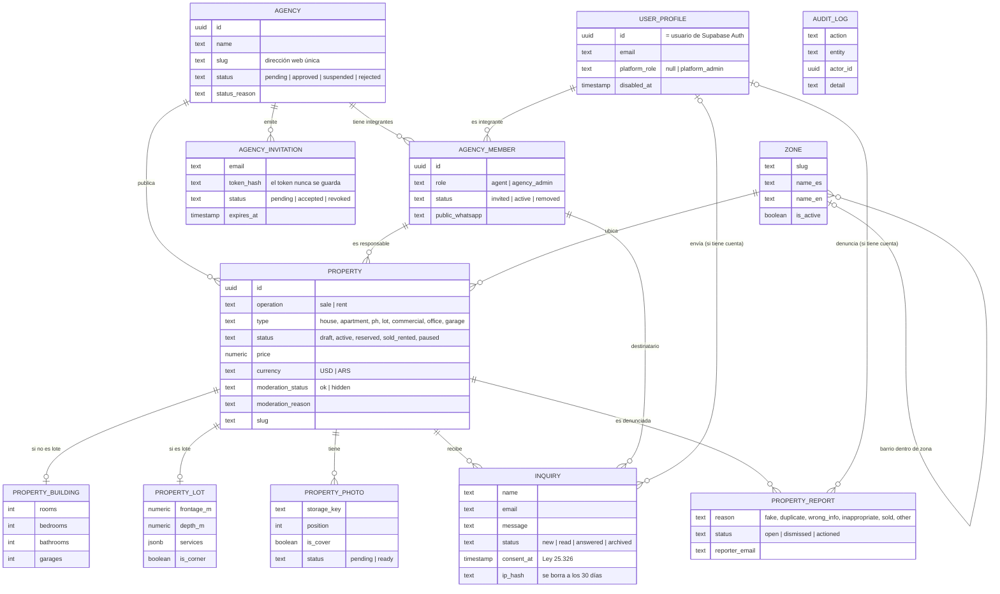

## 2. Arquitectura por capas

Por dónde pasa un pedido. Lo importante: ninguna pantalla habla con la base directamente. Todo pasa por un servicio, que recibe quién es la persona (`Actor`), y la base vuelve a comprobar los permisos con RLS.

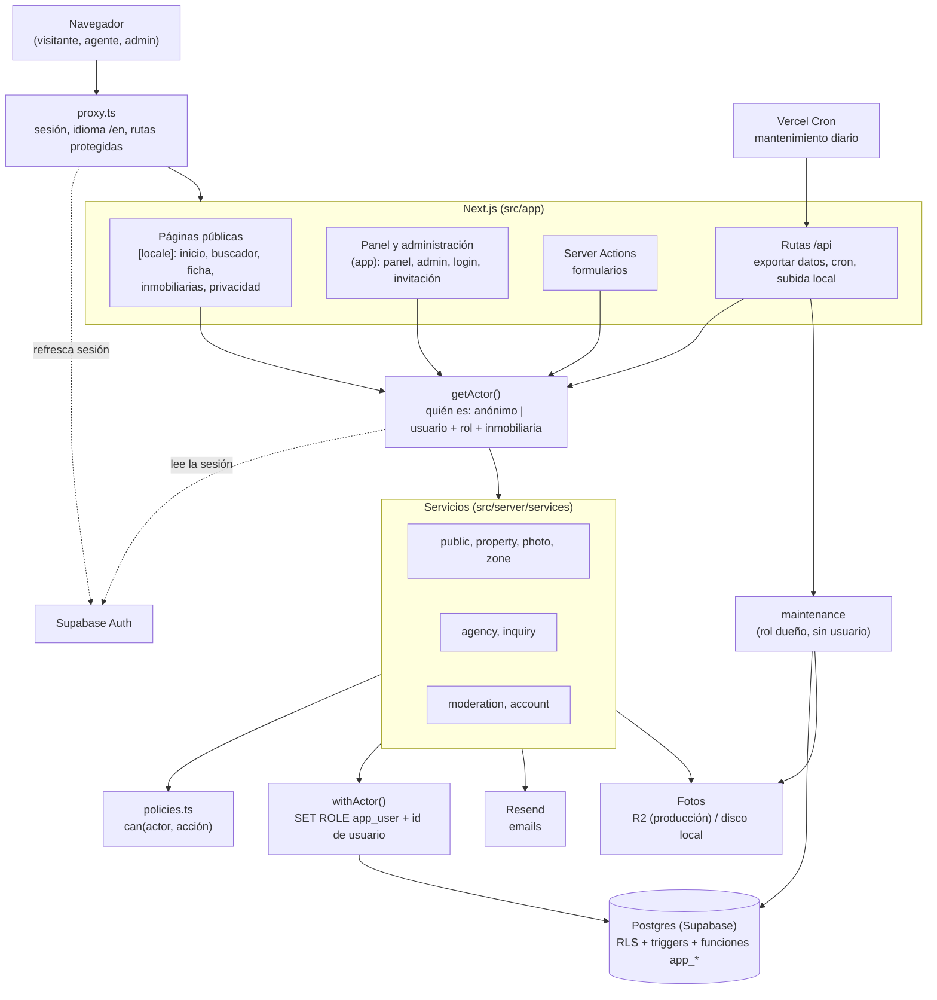

## 3. Quién puede qué

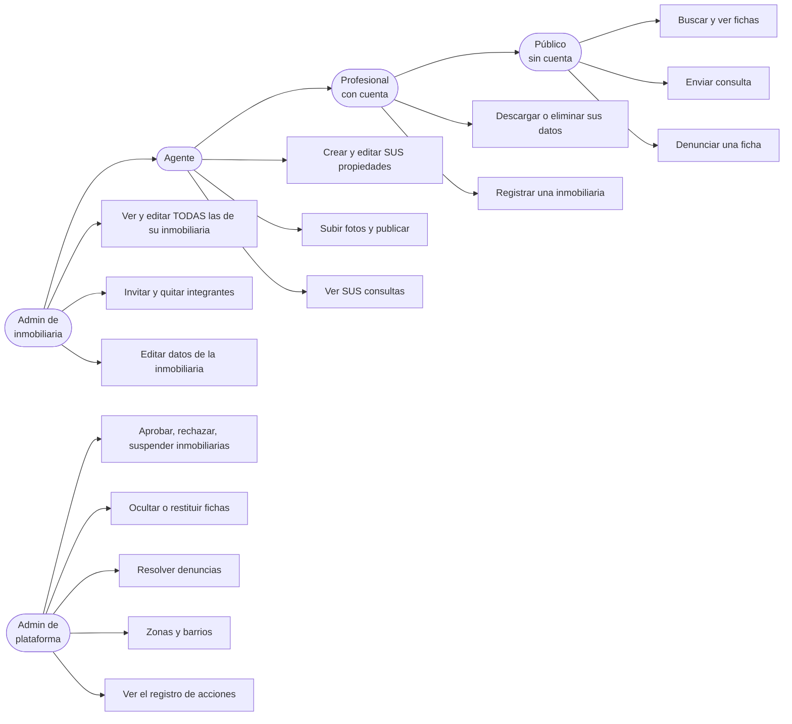

Una flecha de un rol a otro significa "puede todo lo que puede el otro". Un usuario activo pertenece a una sola inmobiliaria. El agente propietario no puede consultar sus propias fichas, ni nadie de su misma inmobiliaria.

## 4. Estados

### Propiedad

El estado lo elige la inmobiliaria. La moderación es independiente: una ficha oculta no se muestra al público aunque esté "activa".

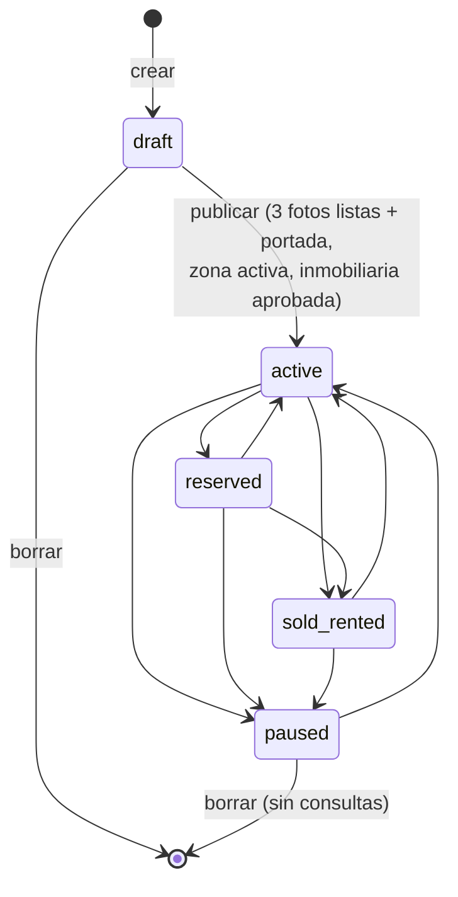

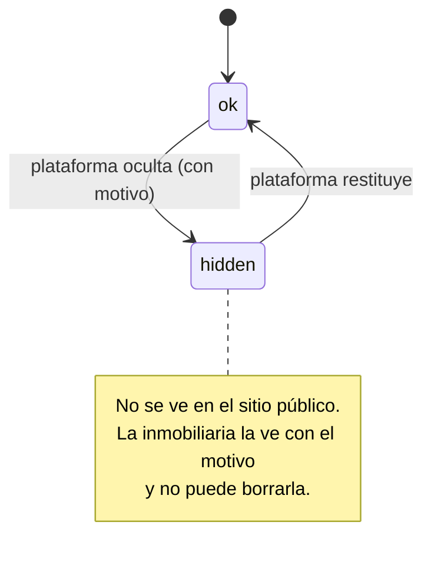

### Inmobiliaria, consulta, invitación y denuncia

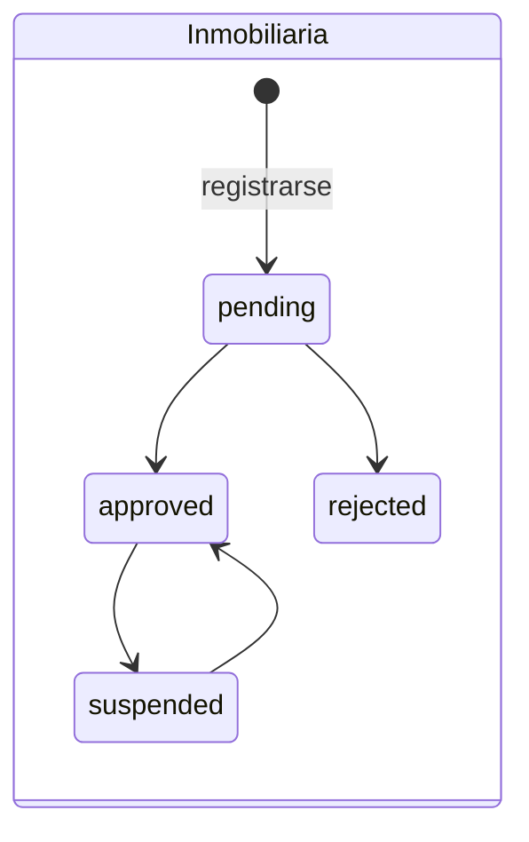

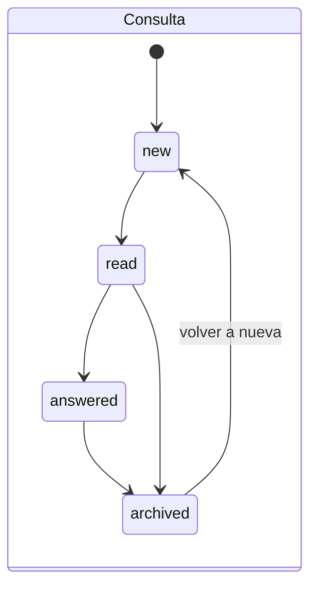

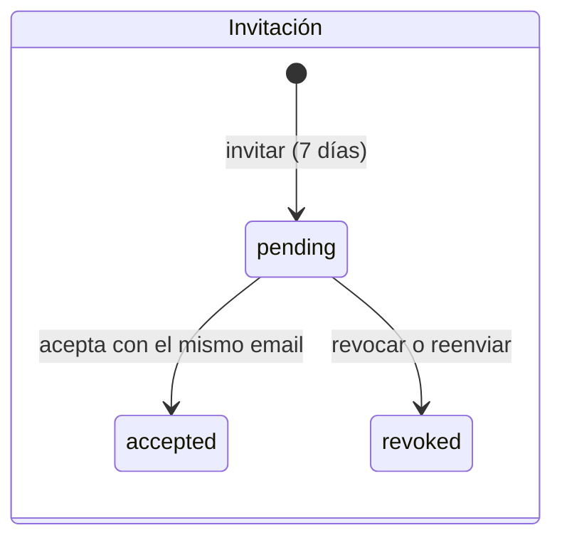

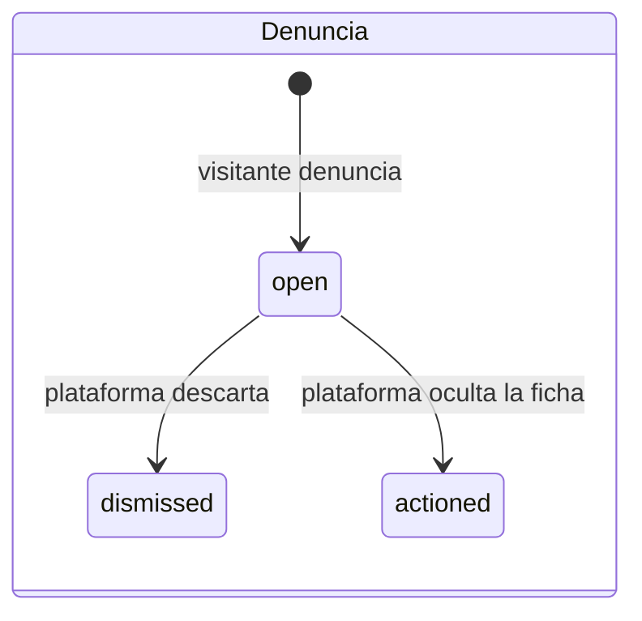

## 5. Secuencias

### Publicar una propiedad con fotos

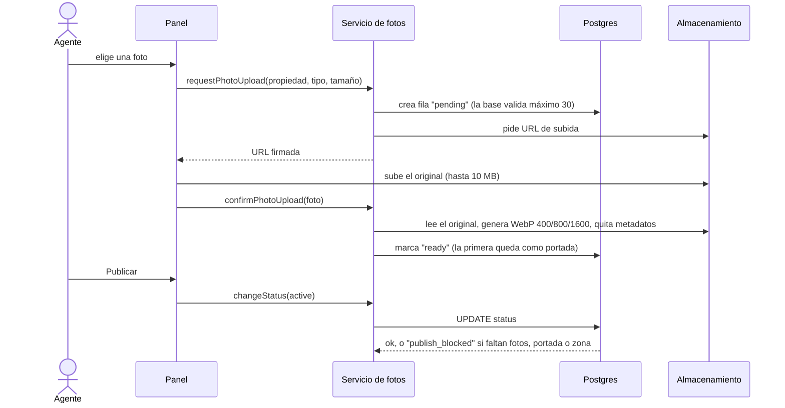

### Consulta de un visitante

```mermaid
sequenceDiagram
  actor Vi as Visitante
  participant F as Ficha pública
  participant S as Servicio de consultas
  participant DB as Postgres
  participant R as Resend
  actor Ag as Agente

  Vi->>F: completa el formulario y acepta el consentimiento
  F->>S: createInquiry(datos, huella de IP)
  S->>S: valida; máximo 5 por hora por IP; descarta bots (campo trampa)
  S->>DB: inserta si la ficha es visible y no es de su propia inmobiliaria
  S->>DB: busca el email de la cuenta del agente (rol dueño)
  S->>R: avisa al agente (Reply-To = visitante)
  S-->>F: listo
  Ag->>DB: abre su bandeja (RLS: solo las suyas, o todas si es admin)
```

### Invitar a un agente

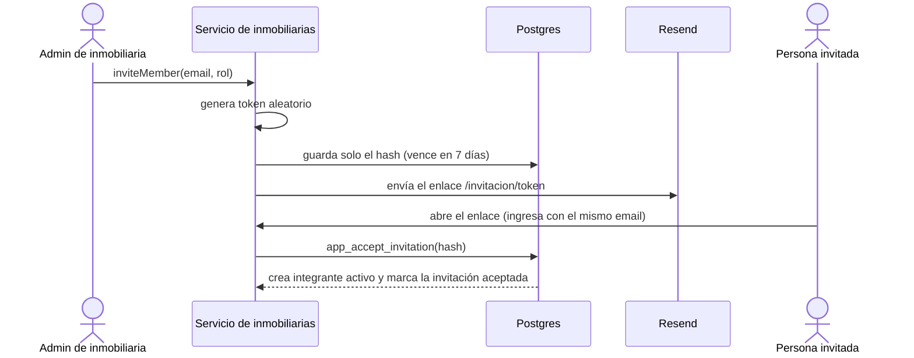

### Denuncia y moderación

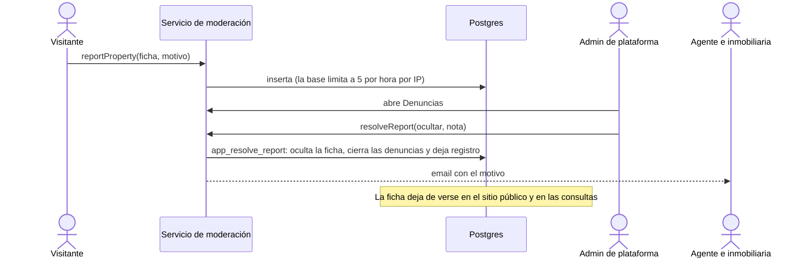

## 6. Servicios y contratos

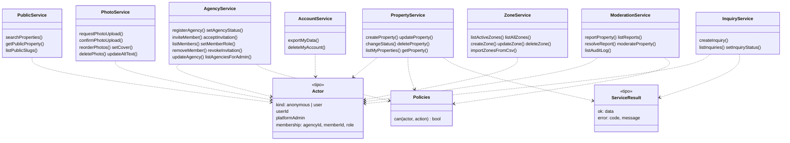

## 7. Mapa de pantallas

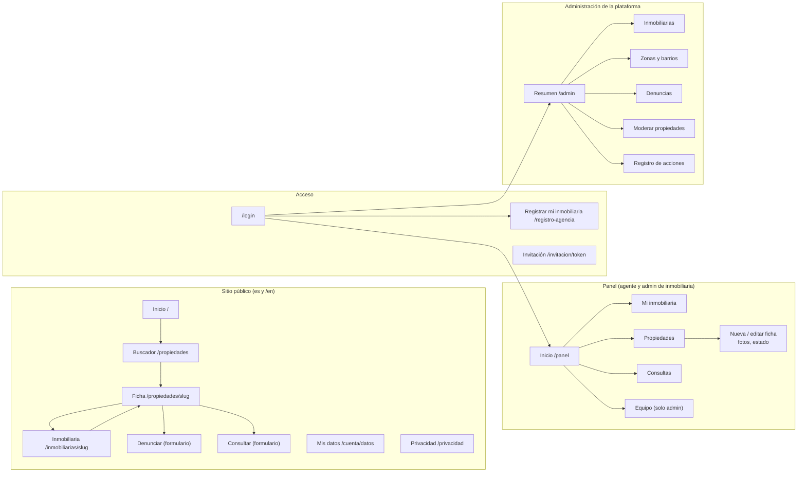
